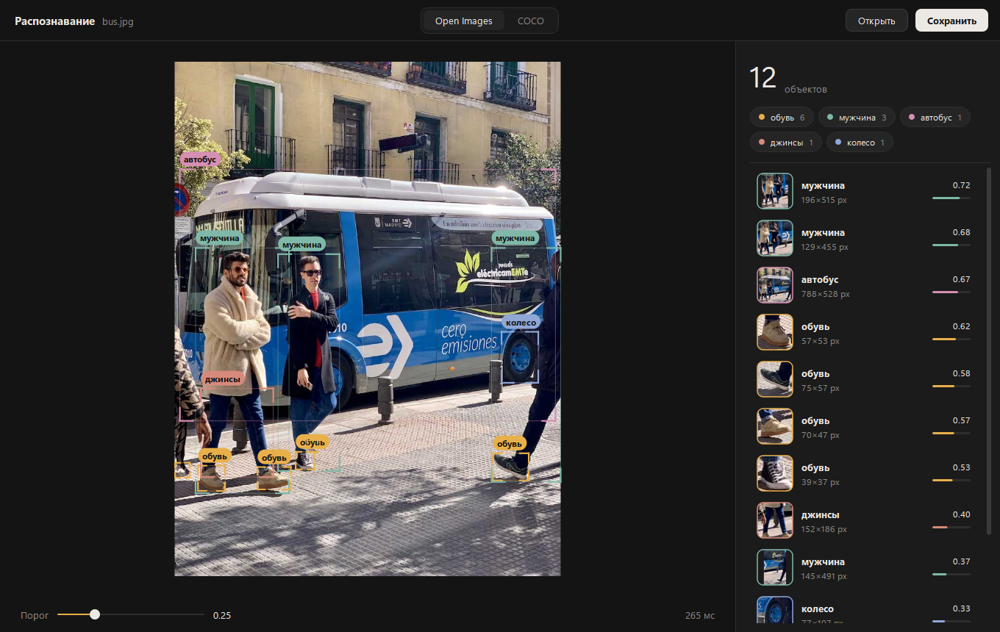

# Распознавание объектов на фото

Десктопное приложение для Windows: находит на фотографии людей, машины, канцелярию
(ручки, линейки, тетради, ластики, ножницы…) и ещё сотни классов предметов.
Работает на обычном процессоре, без видеокарты и без интернета (после первой загрузки моделей).

Стек: Python 3.12 · OpenCV · YOLO (Ultralytics) · OpenVINO · PySide6 (Qt).



## Возможности

- Перетащите фото в окно, откройте через Ctrl+O или вставьте из буфера через Ctrl+V.
- Рамки в стиле видоискателя. При наведении на объект остальное фото затемняется.
- Справа список найденного с миниатюрой каждого объекта и шкалой уверенности.
- Метки классов работают как фильтры: клик скрывает или показывает класс.
- Порог уверенности фильтрует результат мгновенно, без повторного запуска модели.
- Две модели: **Open Images** (~600 классов) и **COCO** (80 классов, точнее на людях и транспорте).
- Ctrl+S сохраняет фото с разметкой.

## Установка

```bat
py install 3.12
py -V:3.12 -m venv .venv
.venv\Scripts\python.exe -m pip install torch torchvision --index-url https://download.pytorch.org/whl/cpu
.venv\Scripts\python.exe -m pip install -r requirements.txt
.venv\Scripts\python.exe export_openvino.py
```

Последняя команда скачивает веса моделей (~30 МБ) в `models\` и конвертирует их в OpenVINO,
что ускоряет работу на процессорах Intel в 2–3 раза.

## Запуск

- **Приложение:** двойной клик по `Raspoznavanie.bat`.
- **Командная строка** (обработка целых папок):
  ```bat
  .venv\Scripts\python.exe detect.py images
  .venv\Scripts\python.exe detect.py images --only Pen Ruler Book --conf 0.15
  .venv\Scripts\python.exe detect.py images --model coco
  ```
  Результаты сохраняются в `results\`: фото с рамками и `report.json`.

## Файлы

| Файл | Назначение |
|---|---|
| `desktop_app.py` | десктопное приложение (PySide6) |
| `detector.py` | ядро: загрузка моделей и распознавание |
| `detect.py` | командная строка |
| `labels_ru.py` | русские названия классов |
| `export_openvino.py` | загрузка и конвертация моделей |

## Примечания

- Тетрадь обе модели распознают как **Book**. Open Images часто называет людей `Man`/`Woman`.
- Распознавание принудительно идёт на CPU (`device="cpu"`). На некоторых ПК OpenVINO
  пытается задействовать встроенную графику Intel, и процесс падает с ошибкой 0xC0000005.
- Лицензия Ultralytics: AGPL-3.0.
